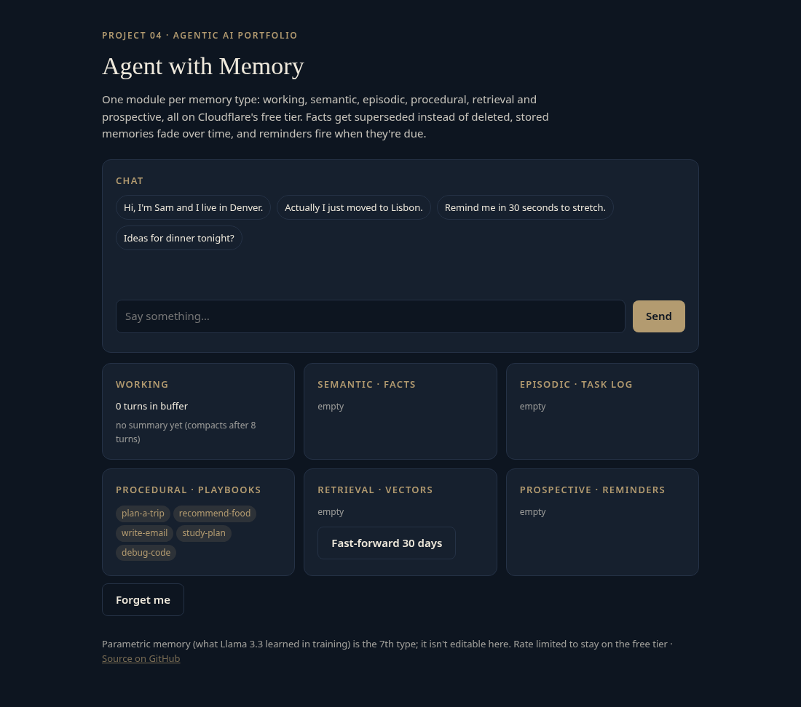
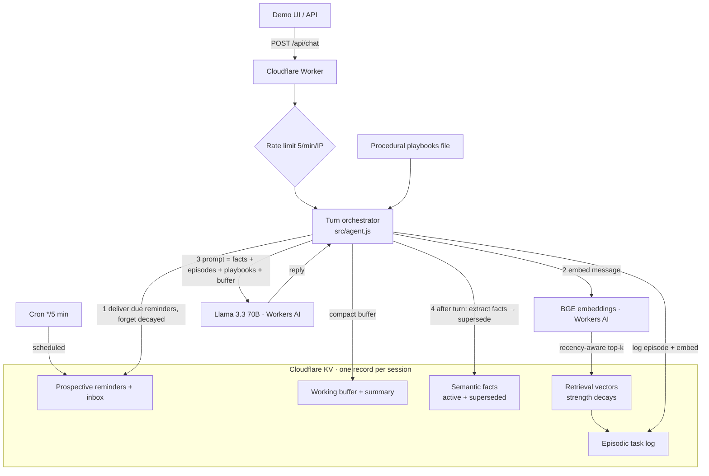

# agent-04-memory

A chat agent with **seven types of memory**, each in its own module, on Cloudflare Workers and the free Workers AI tier. Changed facts are superseded rather than deleted, stored memories decay and get forgotten, retrieval favors recent memories, and reminders fire on schedule. Project 4 of a 10-part agentic AI portfolio.

**Live demo:** https://agent-04-memory.braylo777.workers.dev



## Memory types
| Type | Module | What it does |
|---|---|---|
| Working | `src/memory/working.js` | The context buffer. After each turn, never mid-turn, it keeps the last 4 turns once it passes 8 and folds older ones into a bounded summary. |
| Semantic | `src/memory/semantic.js` | Facts about the user as key/value slots (name, location, job…). A new value **supersedes** the old one: the old fact stays with `superseded_at` / `superseded_by` and is dropped from the prompt. Nothing is deleted. |
| Episodic | `src/memory/episodic.js` | A log of past tasks and their outcomes. Each episode is embedded, and similar later requests pull the past outcome into the prompt. |
| Procedural | `src/memory/playbooks.js` | The skills/playbooks file: step-by-step how-tos (plan a trip, recommend food, write an email…) chosen by trigger words and injected as instructions. |
| Retrieval | `src/memory/retrieval.js` | A vector store: BGE embeddings from Workers AI, cosine similarity, kept in KV. Scoring is **recency-aware**: `score = cosine + 0.15 × strength`. |
| Prospective | `src/memory/prospective.js` | Reminders ("remind me in 10 minutes to…"). A `*/5` cron trigger delivers due reminders, and every request checks too, so they fire on time in the demo. |
| Parametric | (none) | What Llama 3.3 learned in training. It can't be edited at runtime; the other six types exist to add to or override it. |

**Forgetting:** each retrieval item has `strength = 0.5^(days since last use / 14)`. Below 0.05 (about 60 days unused) it is forgotten. Recalling an item refreshes it. Sessions also expire from KV after 30 days.

## Architecture


## How it works
One turn: deliver due reminders → drop forgotten vectors → embed the message → recency-aware search over past episodes and notes → pick playbooks → build the prompt from active facts, relevant episodes, playbooks and the full working buffer → Llama 3.3 replies → **after the turn**, extract facts as JSON and supersede changed ones, log the episode, schedule any reminder, compact working memory, save.

API: `POST /api/chat`, `GET /api/memory?session=`, `POST /api/remember` (store a note), `POST /api/recall` (recency-aware search, returns similarity, recency and score), `POST /api/age` (shifts one session's timestamps back N days to show decay without waiting), `POST /api/forget`.

## Eval results
Live eval against the deployed agent (`node evals/run.mjs`): 29 cases across recall (10), supersede (6), recency ranking (5), forgetting (4) and reminder firing (4). Output is in [`evals/results.json`](evals/results.json).

| Metric | Result |
|---|---|
| Recall accuracy (tell a fact, then ask) | **10/10** |
| Supersede correctness | not yet run live |
| Recency ranking accuracy | not yet run live |
| Forgetting accuracy | not yet run live |
| Reminder firing | not yet run live |
| Latency p50 / p95 | not recorded (run interrupted) |

**Status: partial.** On Oct 27, 2026 the recall section finished, then the account's shared Workers AI daily free allocation (10,000 neurons) ran out at the first supersede case. The other sections will be filled in after the daily reset, and no numbers are estimated in the meantime. Those behaviors are covered by the unit tests below in the meantime.

## Tests
26 offline unit tests (`node:test`, Workers AI and KV mocked), with dedicated tests for each module:
- **Working (3):** no early compaction, keeps newest turns and summarizes the rest, bounded summary.
- **Semantic (4):** add, supersede with links both ways, same value only confirms, multi-step supersede chain.
- **Episodic (2):** logging, cap and lookup.
- **Procedural (3):** trigger selection and ranking, word boundaries, playbook file shape.
- **Retrieval (5):** half-life decay, recency breaks ties, strong similarity beats recency, forgetting drops only decayed items, recall refreshes an item.
- **Prospective (2):** parsing relative reminders, fires only due reminders, exactly once.
- **Integration (7):** supersede through a chat turn, episodic recall reaching the prompt, playbook injection, compaction after the turn and never mid-turn, cron firing a chat-scheduled reminder, recency plus forgetting through the API, HTTP validation.

```bash
npm test
```

## Run it
```bash
npm install
npm test                               # offline unit tests (Node 20+)
npx wrangler kv namespace create KV    # put the id in wrangler.toml
npx wrangler dev
npx wrangler deploy                    # free tier: Workers AI, KV, cron, rate limiting
node evals/run.mjs                     # live eval, throttled; writes evals/results.json
```

## Stack
Cloudflare Workers · Workers AI (Llama 3.3 70B, BGE base embeddings) · KV · Cron Triggers · Rate Limiting · esbuild · node:test

## License
MIT
